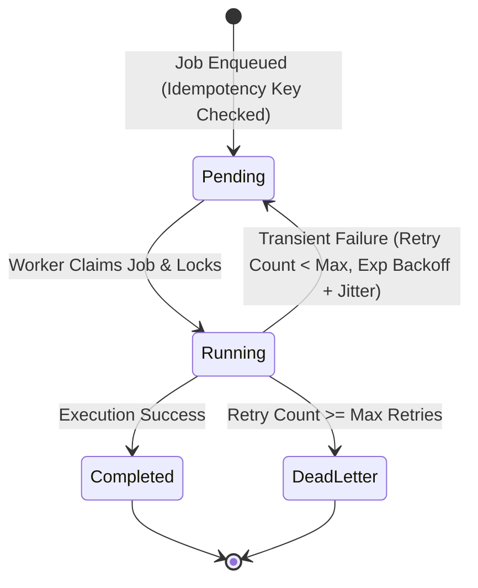

# GrowthSignal AI — System Architecture & Design Specification

## 1. Architectural Overview

GrowthSignal AI is designed with a layered, decoupled service architecture where external providers (search APIs, web probers, LLMs, and email dispatchers) are isolated behind typed domain adapters.

```
┌────────────────────────────────────────────────────────┐
│               Next.js App Router (UI)                  │
│  Overview • Pipelines A/B • Dossier • Approvals • Jobs │
└──────────────────────────┬─────────────────────────────┘
                           │ HTTP / JSON
┌──────────────────────────▼─────────────────────────────┐
│                 Next.js API Handlers                   │
│   /api/discovery • /api/businesses • /api/outreach     │
│   /api/campaigns • /api/compliance • /api/jobs         │
└──────────────────────────┬─────────────────────────────┘
                           │
┌──────────────────────────▼─────────────────────────────┐
│                 Domain Services Layer                  │
│                                                        │
│  ┌──────────────────┐  ┌─────────────────────────────┐ │
│  │ Discovery Engine │  │ SSRF-Protected Web Verifier │ │
│  └────────┬─────────┘  └──────────────┬──────────────┘ │
│           │                           │                │
│  ┌────────▼───────────────────────────▼──────────────┐ │
│  │   Explainable ICP & Multi-Pipeline Scorer         │ │
│  │   (Pipeline A: Web Dev | Pipeline B: AI/Software) │ │
│  └────────────────────┬──────────────────────────────┘ │
│                       │                                │
│  ┌────────────────────▼──────────────────────────────┐ │
│  │   AI Outreach Studio & Prompt Injection Guard     │ │
│  └────────────────────┬──────────────────────────────┘ │
│                       │                                │
│  ┌────────────────────▼──────────────────────────────┐ │
│  │   Compliance Guard & Email Dispatch Service       │ │
│  └────────────────────┬──────────────────────────────┘ │
│                       │                                │
│  ┌────────────────────▼──────────────────────────────┐ │
│  │   Durable Transactional Job Queue & Workers       │ │
│  └───────────────────────────────────────────────────┘ │
└──────────────────────────┬─────────────────────────────┘
                           │
┌──────────────────────────▼─────────────────────────────┐
│             Data Layer / Persistence                   │
│    Supabase PostgreSQL (RLS) + In-Memory Fallback      │
└────────────────────────────────────────────────────────┘
```

---

## 2. The Two Core Pipelines

### Pipeline A — Website Opportunities
*Target Audience*: Local commercial establishments, HVAC, plumbing, dental clinics, specialty trade, retail commerce.
- **Criteria**:
  1. Business must show verified evidence of commercial activity (active state/provincial registrations, positive customer reviews, or active physical location).
  2. Website status check resolves to `apparently_absent`, `social_only`, `parked`, or `broken`.
  3. No prior presence of custom web infrastructure.
- **Service Fit**: Turnkey responsive web applications, automated customer intake, online appointment booking, and local search visibility.

### Pipeline B — AI & Software Opportunities
*Target Audience*: Early-stage and funded startups, SaaS providers, digital marketing agencies, logistics and health tech scale-ups.
- **Criteria**:
  1. Active technical expansion (public job postings for Python engineers, full-stack developers, AI architects, data engineers).
  2. Public announcements of funding, new feature rollouts, or operational scaling hurdles.
  3. Evident need for LLM/RAG knowledge retrieval, PDF/document intelligence, data pipelines, custom APIs, or white-label engineering.
- **Service Fit**: Senior full-stack AI development, custom RAG systems, Python backend services, ETL/data pipelines, and white-label engineering partnerships.

---

## 3. Explainable Lead Scoring Algorithm

Every prospective lead is evaluated across six independent dimensions:

$$\text{Overall Score} = \sum (\text{Dimension Score} \times \text{Weight})$$

| Dimension | Pipeline A Weight | Pipeline B Weight | Evaluated Attributes |
| :--- | :--- | :--- | :--- |
| **Activity Score** | 30% | 20% | Verified registrations, review frequency, hiring signals |
| **Website Opportunity** | 40% | 5% | Domain absence, parked registrar landing, social-only redirection |
| **AI / Tech Opportunity** | 0% | 45% | Documented demand for LLMs, RAG, Python, data pipelines, APIs |
| **Service Fit** | 10% | 15% | Alignment with Senior Full-Stack AI Developer skillsets |
| **Contact Quality** | 10% | 10% | Direct verified email, phone, decision-maker seniority |
| **Confidence & Freshness**| 10% | 10% | Decay calculation based on observation age (30/90/180 days) |

---

## 4. Durable Job Queue State Machine



---

## 5. Security & Isolation Boundaries

1. **Untrusted External Data**: All text harvested from third-party sites is treated as passive, untrusted input. It is sanitized to remove prompt injection tokens and wrapped in `<UNTRUSTED_EXTERNAL_DATA nonce="...">` boundaries.
2. **Network Isolation**: Outgoing HTTP probes to candidate domains are subject to strict SSRF pre-flight validation. Hostnames resolving to private subnets (RFC 1918), loopback, link-local, cloud metadata, or multicast are terminated before the socket connects.
3. **Draft-Only Gate**: Outreach emails cannot be sent directly from an AI prompt. They must be materialized as database drafts and explicitly signed off by an administrator before campaign dispatch.
