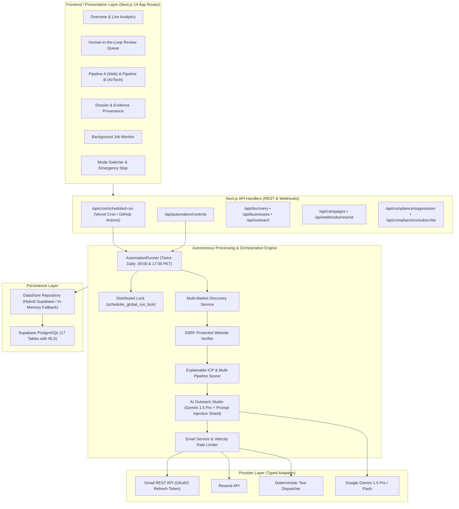

# Growth System Agent — System Architecture & Design Specification

> **Platform**: Growth System Agent  
> **Architect & Owner**: Zia Ul Din (`ziauldin371@gmail.com`)  
> **Identity**: Full Stack AI Developer & Automation Architect | LLMs & Python | Data Science  
> **Repository**: [github.com/ziauldin371-ai/growth-system-agent](https://github.com/ziauldin371-ai/growth-system-agent)  
> **Deployment Target**: Vercel (Next.js App Router) + Supabase (PostgreSQL with RLS)  

---

## 1. Architectural Overview

**Growth System Agent** is built with a layered, decoupled service architecture. External dependencies (search APIs, web probers, LLMs, and email dispatchers) are isolated behind typed domain adapters, supporting both live production providers and deterministic in-memory mock implementations for automated testing and offline development.

---

## 2. The Two Core Pipelines

### Pipeline A — Website Opportunities
*Target Audience*: Local commercial establishments, HVAC, plumbing, dental clinics, specialty trade, retail commerce across US, UK, CA, AU.
- **Criteria**:
  1. Business must show verified evidence of commercial activity (active state/provincial registrations, positive customer reviews, or active physical location).
  2. Website status check resolves to `apparently_absent`, `social_only`, `parked`, or `broken`.
  3. No prior presence of custom web infrastructure.
- **Service Fit**: Turnkey responsive web applications, automated customer intake, online appointment booking, and local search visibility.

### Pipeline B — AI & Software Opportunities
*Target Audience*: Early-stage and funded startups, SaaS providers, digital marketing agencies, logistics and health tech scale-ups.
- **Criteria**:
  1. Active technical expansion (public job postings for Python engineers, full-stack developers, AI architects, data engineers).
  2. Public announcements of funding, new feature rollouts, or operational scaling hurdles.
  3. Evident need for LLM/RAG knowledge retrieval, PDF/document intelligence, data pipelines, custom APIs, or white-label engineering.
- **Service Fit**: Senior full-stack AI development, custom RAG systems, Python backend services, ETL/data pipelines, and white-label engineering partnerships.

---

## 3. Explainable Lead Scoring Algorithm

Every prospective lead is evaluated across six independent dimensions:

$$\text{Overall Score} = \sum (\text{Dimension Score} \times \text{Weight})$$

| Dimension | Pipeline A Weight | Pipeline B Weight | Evaluated Attributes |
| :--- | :--- | :--- | :--- |
| **Activity Score** | 30% | 20% | Verified registrations, review frequency, hiring signals |
| **Website Opportunity** | 40% | 5% | Domain absence, parked registrar landing, social-only redirection |
| **AI / Tech Opportunity** | 0% | 45% | Documented demand for LLMs, RAG, Python, data pipelines, APIs |
| **Service Fit** | 10% | 15% | Alignment with Senior Full-Stack AI Developer skillsets |
| **Contact Quality** | 10% | 10% | Direct verified email, phone, decision-maker seniority |
| **Confidence & Freshness**| 10% | 10% | Decay calculation based on observation age (30/90/180 days) |

---

## 4. Scheduling & Distributed Execution Engine

### Execution Rhythm
- **Twice Daily**: 09:00 PKT (04:00 UTC) and 17:00 PKT (12:00 UTC)
- **Vercel Cron**: Configured via `vercel.json` (`0 4 * * *`) for free Hobby plan compliance.
- **GitHub Actions Fallback**: Template provided in `templates/workflows/scheduled-run.yml` (`0 4,12 * * *`) to trigger the cron endpoint with `CRON_SECRET` for free-tier twice-daily scheduling.
- **Anti-Overlap Distributed Lock**: `acquireLock('scheduler_global_run_lock', 600000)` prevents duplicate runs.
- **State Controls**:
  - `isAutomationPaused()`: Global pause switch evaluated before every step.
  - `getOperatingMode()`: Evaluates mode (`research`, `approval`, `auto_send`).

---

## 5. Security & Compliance Architecture

1. **SSRF and DNS Rebinding Defense**:
   - Every outbound URL is resolved to raw IP addresses.
   - Private IPs (RFC 1918), loopback (`127.0.0.1`), link-local (`169.254.0.0/16`), and multicast addresses are rejected.
   - Validation occurs on the initial URL and on **every HTTP redirect hop**.
2. **Prompt Injection Boundary Protection**:
   - External text and third-party notes are treated as untrusted data.
   - Wrapped in cryptographically unique delimiter tags with nonces: `<<<UNTRUSTED_EVIDENCE_{NONCE}>>>`.
   - Explicit LLM instructions reject instruction overrides from untrusted content.
3. **Email Velocity Rate Limiting**:
   - Hard maximum limit of **3 emails per recipient domain per 24 hours**.
   - Dispatches outside 09:00–17:00 local business hours are blocked by `ComplianceGuard`.
4. **Gmail OAuth2 REST API**:
   - Personal `@gmail.com` addresses use official OAuth2 tokens (`GOOGLE_REFRESH_TOKEN`).
   - No plaintext passwords or app passwords are ever stored.
   - RFC 2822 multipart MIME structure (`plainText` + `htmlText`) base64url-encoded.
5. **CSV Formula Injection Neutralization**:
   - Spreadsheet formula triggers (`=`, `+`, `-`, `@`, `\t`, `\r`) are sanitized with single-quote escaping prior to CSV export.
6. **Supabase Row Level Security (RLS)**:
   - 17 tables secured with organization-scoped RLS policies.
   - Anonymous access is strictly prohibited for sensitive lead and email records.
