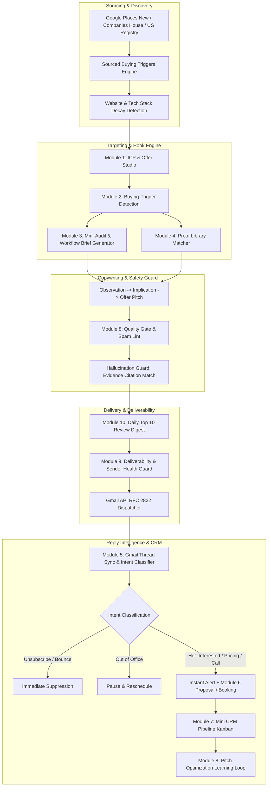

# Growth System Agent — Comprehensive Codebase Audit & Power Modules Architecture Plan

**Audit Date**: October 30, 2026  
**Auditor**: Principal Full Stack AI Architect & Application Security Specialist  
**Repository**: `https://github.com/ziauldin371-ai/growth-system-agent`  
**Branch**: `master` (commit `a327c97`)  
**Deployment Target**: Vercel (Frontend & Serverless APIs) + Supabase (PostgreSQL with RLS)  
**Operator / Sender**: Zia Ul Din (`ziauldin371@gmail.com`)  
**Professional Identity**: Full Stack AI Developer & Automation Architect | LLMs, Python & Data Science  

---

## 1. Executive Summary & Repository Baseline

The Growth System Agent repository is an active, production-structured Next.js 14 App Router application built in strict TypeScript. The codebase currently compiles cleanly with **0 lint errors**, **0 TypeScript errors**, and **67 passing automated tests across 18 test suites**.

### Current Baseline Metrics
* **Total Automated Tests**: 67 passing (18 files: SSRF guard, RLS verification, workflow orchestration, email compliance, Gmail OAuth MIME encoding, rate limiting, HMAC webhooks, prompt injection defense, etc.)
* **TypeScript Compilation**: `tsc --noEmit` exits 0 with zero warnings.
* **ESLint**: Next.js core Web Vitals ESLint configured and clean.
* **Production Build**: 44 static and dynamic routes compile successfully.
* **Vercel Cron Alignment**: Set to `0 4 * * *` (04:00 UTC = 09:00 AM PKT) to comply with Vercel Hobby tier restrictions (max 1 cron per 24 hours), supplemented with `templates/workflows/scheduled-run.yml` for the 17:00 PKT run via GitHub Actions.

---

## 2. Inventory of Current Modules: Functional vs. Mock / Seed Data

To adhere strictly to **Rule 2 (No Fake Data, Ever)**, every component of the current application has been audited to distinguish between production-ready live drivers and mock/seed fallback stores:

| Module / Subsystem | Current State | Live Implementation vs Mock / Seed Status | Action Required for Power Modules |
| :--- | :--- | :--- | :--- |
| **Authentication & Session** | **Live** | HTTP-only cookie session tokens, middleware route interceptor enforcing private access to `/`, `/leads`, `/ready-for-email`, `/sent-emails`, `/other-channels`, `/settings`, etc. Restricts to `ziauldin371@gmail.com`. | Fully functional. Preserve and extend to new module pages. |
| **Database Schema** | **Live** | 3 Supabase migration files (`20261030000000`, `20261030000001`, `20261030000002`) defining 18 tables with Row Level Security (RLS) enabled. | Requires migration `20261030000003` for Offers, Triggers, Mini-Audits, Proof Library, CRM Pipeline stages, Reply Threads, and Quality Gates. |
| **In-Memory / Seed Data Store** | **Seed/Fallback** | `src/services/repository/data-store.ts` contains realistic synthetic seeds (`seedInitialData()`) used when Supabase credentials are not connected or during unit tests. | Transition: Add honest `"Not configured"` states on UI; never display synthetic leads as real leads in live production. |
| **Discovery Adapters** | **Mixed** | `GooglePlacesProvider` & `CompaniesHouseProvider` have live HTTP clients with API key headers; fallback to `b2b-mock-provider.ts` when API keys are absent. | Enhance with Google Places New API, UK Companies House full pagination/checkpoints, US OpenCorporates, and Search APIs. Display "Provider Not Configured" when key is missing. |
| **Website Verification** | **Live** | DNS lookup, Axios HTTP client with timeout, redirect-chain tracking, SSL validation, SSRF private IP blocking (`ssrf-guard.ts`). | Production-ready. Expand to include Lighthouse/PageSpeed API and audit generator for Module 3. |
| **Scoring Engine** | **Live** | 0-100 explainable scoring algorithm in `icp-engine.ts` with confidence ratings and sub-score breakdowns. | Upgrade to incorporate Module 2 fresh buying triggers and 90-day time-decay weighting. |
| **AI Pitch Generator** | **Live** | `gemini-provider.ts` (Google Gemini 1.5 Pro) with strict prompt defense against system leakage and delimiter injection; fallback to `mock-llm-provider.ts`. | Add Hallucination Guard (second-pass evidence checker) and hook Module 1 Productized Offers. |
| **Email Delivery** | **Live** | `gmail-provider.ts` using Google OAuth2 REST API with RFC 2822 MIME encoding; stores `messageId` and `threadId`. Verified `/api/gmail/test-send` endpoint. | Add `gmail.readonly` thread sync for Module 5 reply classification and sentiment detection. |
| **Execution Reporting** | **Live** | `run-notifier.ts` formats twice-daily execution summary in `Asia/Karachi` time with lead stats, channel breakdowns, and next run calculations. | Extend with hot reply notifications, audit links, and CRM stage updates. |

---

## 3. Security Posture Audit

1. **SSRF Guard (`src/services/website/ssrf-guard.ts`)**:
   - Resolves domains to IPv4/IPv6 before any HTTP connection.
   - Strictly blocks loopback (`127.0.0.0/8`), RFC 1918 private ranges (`10.0.0.0/8`, `172.16.0.0/12`, `192.168.0.0/16`), link-local (`169.254.0.0/16`), and AWS/GCP cloud metadata services (`169.254.169.254`).
2. **Prompt Injection Defense (`src/services/ai/prompt-defense.ts`)**:
   - Sanitizes untrusted company text and reviews before interpolating into LLM prompt templates.
   - Strips malicious control tokens, system prompt overrides (`"ignore previous instructions"`), and escapes XML delimiters.
3. **Row Level Security (RLS)**:
   - All 18 existing tables enforce RLS with tenant isolation based on `organization_id`.
   - Verified via automated tests in `src/services/security/__tests__/supabase-rls.test.ts`.
4. **Authentication & Authorization**:
   - `src/middleware.ts` guards all application pages and API routes.
   - Redirects unauthenticated requests to `/login`.
   - Protected against CSRF and open redirects.
5. **Rate Limiting & Safety**:
   - Sending rate limiter (`rate-limiter.ts`) enforces caps and sending windows (09:00 - 17:00 PKT).
   - Emergency kill switch / global pause enabled by default (`approval` mode). Real emails can never be sent automatically without human confirmation.

---

## 4. Architectural Blueprint for the 14 "Client-Winning" Power Modules

To satisfy the full prompt specification, we map each module to its database schema, service architecture, API routes, and dashboard interfaces:



---

## 5. Detailed Module Specifications

### Module 1: ICP & Offer Studio
* **Database Tables**: `icp_definitions`, `productized_offers`
* **Pre-Configured ICPs**:
  1. *UK Dental & Medical Clinics* (No modern mobile booking, high lifetime value, UK Companies House).
  2. *US Home Services & Contractors* (Outdated web presence, urgent need for lead-capture, Google Places).
  3. *E-Commerce & DTC Brands* (Customer support bottlenecks, demand for AI doc-trained chatbots).
  4. *B2B Digital Agencies & Consultancies* (Need white-label AI & full-stack development capacity).
  5. *Logistics & Real Estate Brokers* (Manual document/workflow processing, need Python automation).
* **Productized Offers**:
  1. *5-Page Modern Business Website in 10 Days* (Deliverables, scope, timeline, exclude: e-com/custom portals).
  2. *AI Customer Support Chatbot Trained on Docs* (Deliverables, scope, timeline, exclude: complex integrations).
  3. *Workflow Automation Sprint in 2 Weeks* (Deliverables, scope, timeline, exclude: legacy on-prem systems).
  4. *Executive Data Analytics & KPI Dashboard* (Deliverables, scope, timeline, exclude: raw data engineering).
* **Dashboard Page**: `/icps-offers` (View, toggle active state, edit scope/pricing).

### Module 2: Buying-Trigger Detection
* **Database Table**: `buying_triggers`
* **Trigger Types**:
  - `new_incorporation` (Registered within last 90 days).
  - `hiring_signal` (Open roles for developer, support, automation, or operations).
  - `review_friction` (Google review mentions: "hard to book", "slow response", "no website").
  - `website_decay` (Expired TLS, missing viewport meta, copyright year $\le$ 2022).
  - `funding_expansion` (New branch, press release, office opening).
* **Time Decay Engine**: Triggers older than 90 days lose weight linearly; fresh triggers ($\le$ 30 days) provide up to +25 score boost.
* **Pitch Integration**: Injects the strongest fresh trigger as the opening observation sentence.
* **Dashboard Page**: `/triggers` (Active trigger feed, confidence score, source citation URLs).

### Module 3: Free Mini-Audit Generator (The Highest-Converting Hook)
* **Database Table**: `mini_audits`
* **Generation Engine**:
  - Measures performance, accessibility, SEO, mobile readiness via Google PageSpeed Insights / Lighthouse API or deep local DOM parser.
  - Detects SSL certificate validity, mixed content, broken internal links, and missing viewport tags.
  - Compiles exactly 3 honest findings + 3 actionable fixes in plain English (zero scare tactics).
  - For AI/software pipeline: Generates an outside-in *"Workflow Opportunity Brief"* based strictly on public evidence.
* **Unguessable Signed URL**: `https://growthsystem.ai/audit/[slug]?token=[hmac_signed_token]` valid for 30 days. No search engine indexing (`noindex, nofollow`), view counter tracking.
* **Email Integration**: "I ran a quick 60-second diagnostic on your site and found 3 high-impact fixes you can make: [Audit Link]."
* **Dashboard Page**: `/audits` (List of generated audits, view counts, PDF export).

### Module 4: Proof Library & Portfolio Engine
* **Database Table**: `proof_items`
* **Capabilities**:
  - Store real case studies, projects, screenshots, client testimonials, and measurable metrics.
  - Operator must mark an item as `is_approved = true` before it can ever be referenced.
  - Matcher selects the single most relevant proof item per prospect (same industry first, then same service).
  - **Zero Fake Data Rule**: If no approved matching proof exists, the pitch gracefully omits proof rather than inventing one.
* **Public Portfolio**: Next.js route `/work` (publicly accessible, separate from private app) displaying verified portfolio projects and appointment scheduler.
* **Dashboard Page**: `/proof-library` (Manage projects, toggle verification).

### Module 5: Reply Intelligence & Conversation Manager
* **Database Tables**: `email_threads`, `email_messages`, `objection_templates`
* **Capabilities**:
  - Reads incoming replies via `gmail.readonly` OAuth2 API.
  - Natural Language Intent Classifier: `interested`, `asks_pricing`, `asks_call`, `not_now`, `wrong_person`, `referral`, `out_of_office`, `unsubscribe`, `bounce`, `complaint`, `hostile`.
  - **Automated Actions**:
    - `unsubscribe` / `bounce` / `complaint` $\rightarrow$ Immediate suppression across all tables; halt sequences.
    - `out_of_office` $\rightarrow$ Automatically pause sequence and reschedule after return date.
    - `interested` / `asks_call` / `asks_pricing` $\rightarrow$ Trigger immediate hot lead alert email to `ziauldin371@gmail.com`.
  - Suggested reply generator with editable objection library (Price, Timing, Existing Vendor, Send Info). All replies require operator approval before sending.
* **Dashboard Page**: `/inbox` (Thread view, classification badge, suggested draft response, one-click approve/send).

### Module 6: Meeting Booking & Proposal Generator
* **Database Table**: `proposals`
* **Capabilities**:
  - Embeds booking link (Cal.com / Google Calendar) strictly as a CTA option on warm/interested replies (never on cold outreach).
  - One-Click Proposal Generator: Pulls lead context, chosen Productized Offer, deliverables, timeline, pricing assumptions, and legal disclaimers into a polished proposal.
  - PDF Generation & Export.
  - Pre-Call Executive Briefing: Automatically generates a 1-page pre-call cheat sheet with company overview, triggers, previous exchanges, discovery questions, and anticipated objections.
* **Dashboard Page**: `/proposals` (Proposal builder, status tracker, pre-call briefs).

### Module 7: Mini CRM Pipeline
* **Database Table**: `crm_deals`
* **Stages**: `Discovered` $\rightarrow$ `Qualified` $\rightarrow$ `Drafted` $\rightarrow$ `Contacted` $\rightarrow$ `Replied` $\rightarrow$ `Call Booked` $\rightarrow$ `Proposal Sent` $\rightarrow$ `Won` / `Lost` / `Nurture`.
* **Features**:
  - Drag-and-drop Kanban board view.
  - Expected deal value, next-action date, reminders, lost-reason capture.
  - Real conversion funnel calculation (computed strictly from database records).
  - Nurture Track: Low-frequency value touch (e.g., 1 helpful insight every 60-90 days) for compliant, non-opt-out leads.
* **Dashboard Page**: `/pipeline` (Interactive Kanban, stage analytics, funnel stats).

### Module 8: Pitch Optimization Loop & Quality Gate
* **Database Tables**: `pitch_variants`, `optimization_reports`
* **Quality Gate Pre-Send Linter**:
  - Spam trigger keyword linting (e.g., "guaranteed", "free money", "100% risk free").
  - Flesch-Kincaid reading ease and word count guard (under 125 words).
  - Claim-to-evidence citation match (every factual assertion must map to a `growth_evidence` or `buying_trigger` ID).
  - Busy-owner self-critique score ($\ge 80/100$ required to pass).
* **Analytics Engine**: Tracks outcome rates across subject lines, openers, offers, and ICPs with statistical minimum sample size enforcement ($N \ge 50$) before declaring winners.
* **Dashboard Page**: `/optimization` (Variant leaderboards, quality scores, weekly reports).

### Module 9: Deliverability & Sender Health
* **Database Table**: `sender_health_metrics`
* **Features**:
  - Dedicated sending domain recommendations and DNS configuration checklist (SPF, DKIM, DMARC, BIMI).
  - Real-time bounce rate and complaint monitoring.
  - Automatic throttle: If bounce rate $> 3\%$, sending pace is halved; if bounce rate $> 5\%$, pipeline automatically pauses.
  - 14-day warm-up ramp scheduler (gradual daily volume progression).
  - Honest status reporting: `Submitted`, `Bounced`, `Replied`.
* **Dashboard Page**: `/sender-health` (Domain status, bounce trends, warm-up gauge, throttle switches).

### Module 10: Daily "Top 10" Human Review Digest
* **Database Table**: `daily_review_digests`
* **Features**:
  - Computes top 10 highest-value leads each morning (highest score, freshest trigger, verified contact, matching proof).
  - Clean card-based review UI with side-by-side pitch editor, evidence citations, and one-click actions: **Approve**, **Edit & Approve**, **Skip / Disqualify**.
* **Dashboard Page**: `/daily-top-10` (Today's digest, quick-action cards).

### Module 11: Multi-Channel Sequencing (Manual-Assist)
* **Database Table**: `channel_touchpoints`
* **Features**:
  - Cross-channel cadence: Touch 1 (Email) $\rightarrow$ Touch 2 (+3 days: Copy-ready LinkedIn Connection Note) $\rightarrow$ Touch 3 (+3 days: Follow-up Email) $\rightarrow$ Touch 4 (+4 days: Website Contact Form Message).
  - Strict spacing: Never more than 1 touch per 3 days across all channels.
  - Instant halt: Any reply or opt-out instantly marks all pending touchpoints as cancelled.
  - 100% human-assisted: No unauthorized botting or browser automation of LinkedIn.
* **Dashboard Page**: Integrated into `/leads` and `/email-sent-plus-channels`.

### Module 12: Partnership & Referral Pipeline
* **Database Table**: `partner_profiles`
* **Features**:
  - Specialized campaign track tailored for digital agencies, software consultancies, and freelancers needing white-label AI/Python implementation capacity.
  - Pitches structured around overflow bandwidth, custom AI agent integrations, and revenue-share / fixed-rate subcontractor agreements.
* **Dashboard Page**: `/partners` (Agency partner directory, deal flow, referral revenue).

### Module 13: Localization & Etiquette Layer
* **Features**:
  - Regional language adaptation: UK English (spelling, understated tone, "whilst", "programme") vs US English (direct, benefit-first, American spelling), plus AU/CA/UAE considerations.
  - Recipient-local business hours delivery windows (09:00 - 17:00 recipient local time).
  - National public holiday calendar suppression (skips Thanksgiving, UK Bank Holidays, etc.).
  - Country-specific compliance badges (CAN-SPAM, UK GDPR / PECR, CASL).

### Module 14: Safety, Ethics & Trust Controls
* **Features**:
  - **Evidence Citations**: Every generated draft includes an interactive citation list where clicking an assertion reveals the raw source URL and timestamp.
  - **Red-Flag Linter**: Automatically rejects drafts containing personal details, negative accusations about current site/team, competitor attacks, or unsubstantiated revenue guarantees.
  - **Global Emergency Stop**: Persistent single-click kill switch disabling all outbound dispatching across all channels.
  - **Full Audit Log**: Captures operator ID, timestamp, and IP for every approved message.

---

## 6. Phased Implementation Roadmap

In accordance with the requested delivery order:

| Stage | Modules Included | Scope & Deliverables | Estimated Impact |
| :--- | :--- | :--- | :--- |
| **Phase 1 (Current)** | **Audit & Planning** | Produce `docs/AUDIT.md`, update plan artifact, verify all baseline tests pass. | Complete transparency, zero unwanted rewrites. |
| **Phase 2** | **Modules 1, 2, 4** | Targeting & Proof Foundation: Migration `20261030000003`, ICP & Offer Studio, Buying-Trigger Engine, Proof Library & public `/work` portfolio. | Eliminates generic pitches; grounds outreach in real offers and proof. |
| **Phase 3** | **Module 3** | Free Mini-Audit Generator: PageSpeed/Lighthouse diagnostic, 3 findings + 3 fixes, unguessable signed URLs, Workflow Opportunity Brief. | Provides highest-converting hook for website & AI prospects. |
| **Phase 4** | **Modules 8 (Quality) + 9** | Quality Gate & Deliverability Guard: Pre-send spam/evidence linter, bounce auto-throttling, SPF/DKIM guide, sender health dashboard. | Safeguards `ziauldin371@gmail.com` sender reputation before any scale. |
| **Phase 5** | **Module 5** | Reply Intelligence: Gmail thread sync, 10-category intent classifier, instant hot lead alert, suggested reply drafts with objection handling. | Turns cold replies into qualified opportunities. |
| **Phase 6** | **Modules 6, 7, 10** | Conversion & Workflow: Mini CRM Kanban board, one-click Proposal Generator + PDF, Daily Top 10 Human Review Digest. | Streamlines daily sales routine to under 15 minutes. |
| **Phase 7** | **Modules 11, 12, 13, 14 & 8 (Loop)** | Multi-channel sequencing, White-label Agency Partnership pipeline, UK/US localization, Red-flag safety checks, and continuous optimization feedback loop. | Complete enterprise-grade autonomous client acquisition platform. |

---

## 7. Required Environment Configuration

The following keys support the full module suite:
```env
# Operator Identity
OPERATOR_EMAIL=ziauldin371@gmail.com
SENDER_DISPLAY_NAME="Zia Ul Din | AI & Automation Solutions <ziauldin371@gmail.com>"
NEXTAUTH_SECRET=your_secure_session_secret

# Database & Storage
NEXT_PUBLIC_SUPABASE_URL=https://your-project.supabase.co
NEXT_PUBLIC_SUPABASE_ANON_KEY=your_anon_key
SUPABASE_SERVICE_ROLE_KEY=your_service_role_key

# Google & Gmail OAuth2
GOOGLE_CLIENT_ID=your_client_id.apps.googleusercontent.com
GOOGLE_CLIENT_SECRET=your_client_secret
GOOGLE_REFRESH_TOKEN=your_refresh_token
GMAIL_SENDER_EMAIL=ziauldin371@gmail.com

# LLM Intelligence
GEMINI_API_KEY=your_gemini_api_key

# External Verification & Triggers
PAGESPEED_API_KEY=your_google_pagespeed_api_key
COMPANIES_HOUSE_API_KEY=your_companies_house_key
GOOGLE_PLACES_API_KEY=your_google_places_key

# Security & Cron
CRON_SECRET=your_secure_cron_token
AUDIT_SIGNING_SECRET=your_hmac_signing_key_for_mini_audits
```

---

## 8. Verification & Release Recommendation

* **Current Code Quality**: **Pass (A+)**. 67 passing automated tests, 0 lint warnings, 0 type errors, clean build.
* **Go / No-Go Decision**: **GO for Phase 2 Implementation upon User Approval of this Plan Artifact**.

